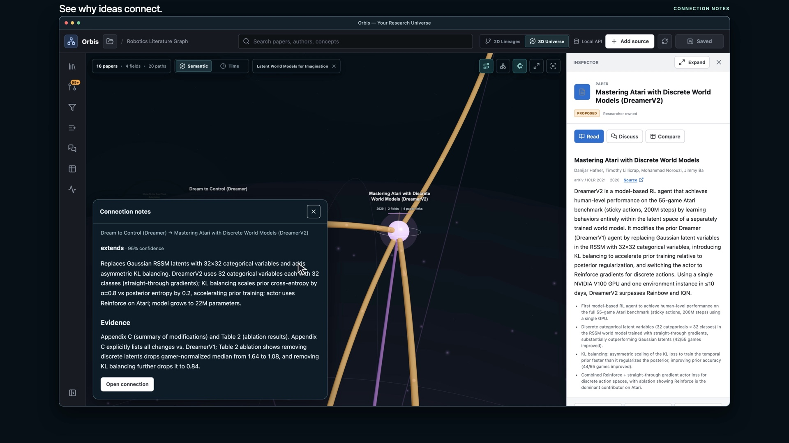

# Orbis

**One place to read, take notes, discuss, and connect your research.**

Orbis is an open-source research app for **macOS and Linux**. Bring together
papers, blog posts, and web pages. Read the original beside your notes, ask your
own AI agent questions, and explore how ideas connect in a 3D research universe.

**Your research. Yours to keep.** Your library lives on your computer. Optional
encrypted Google Drive sync connects your laptops, with no Git push/pull routine
and no always-on Orbis server.

[](https://github.com/Nike353/Orbis/releases/download/orbis-demo/Orbis-demo-1080p.mp4)

**[Watch the two-minute demo](https://github.com/Nike353/Orbis/releases/download/orbis-demo/Orbis-demo-1080p.mp4)**
· [4K version](https://github.com/Nike353/Orbis/releases/download/orbis-demo/Orbis-demo-4K.mp4)

_The demo uses an existing library. A fresh installation starts empty; no personal
papers or notes are included in the app._

## From a source to a connected idea

1. **Add a paper, blog, or web page.** Choose your agent, model, and effort.
   Review its proposed summary, concepts, and connections before adding them.
   Paper summaries cover the problem, background, framework, results, and limitations.
2. **Read and make it yours.** Open the original beside its summary. Highlight
   passages, add comments, and write your own notes with Markdown and LaTeX equations.
   Your notes stay separate from generated content.
3. **Discuss while you read.** Ask questions in the paper's Discuss tab or about
   selected text. Available originals supply passages with page or section citations;
   the app shows when only stored notes were available.
4. **Compare and connect.** Compare papers using criteria you choose, inspect the
   evidence, and export the table. Create your own clusters and relationships.
5. **Explore the bigger picture.** Rotate the 3D universe, focus or filter a
   cluster, and hover over connections to read their explanations. Switch to
   chronological 2D lineages, or keep separate projects in independent graphs.

Orbis works with your installed **Codex or Claude Code CLI** and its existing
account. You choose the model and effort. Agent proposals require review;
Activity shows progress and lets you recover failed tasks. Reading and manual
editing do not require an agent.

## Get started

**Desktop preview · 2.1.0-beta.1.** macOS Apple Silicon and Ubuntu have been
exercised during development. Builds are currently unsigned and unnotarized;
automatic updates are not included. [What has been verified →](docs/MAC_VERIFICATION.md)

### Desktop app

For now, build the app on the computer where you will use it. Install
**Git, Node.js 22, and uv**, then run:

```sh
git clone https://github.com/Nike353/Orbis.git
cd Orbis
npm ci
npm run desktop:build
```

Find your installer in `release/desktop/`:

| System | Install |
| --- | --- |
| macOS | Open the DMG and drag Orbis into Applications. |
| Linux | Install the DEB, or make the AppImage executable and open it. |

The build packages the local runtime. After installation, click Orbis to launch;
you do not need a terminal, Node, or Python to open it. Build on the target OS
and CPU architecture. The [desktop guide](docs/DESKTOP.md) covers prerequisites,
agent detection, upgrades, and troubleshooting.

You can also build preview installers using the
[manual desktop workflow](https://github.com/Nike353/Orbis/actions/workflows/desktop.yml).
Its downloadable Actions artifacts require a GitHub sign-in. The demo video
release is media only, not an app installer.

### Try it in your browser

```sh
git clone https://github.com/Nike353/Orbis.git
cd Orbis
sh start.sh
```

Open the local URL printed in the terminal. The launcher sets up its managed
tools; first launch needs internet and can take several minutes. The library
is stored outside the app checkout. Choose another location with:

```sh
sh start.sh --workspace /path/to/my-library
```

Browser mode supports local research workflows. Google sign-in and encrypted
Drive sync require the desktop app.

### Your first session

1. Install and sign in to Codex or Claude Code for AI features, then restart Orbis.
2. Choose **Add source**, paste a URL, and review the agent's proposal.
3. Open the source with **Read**. Attach or retrieve its PDF/article, then try
   **My notes**, **Discuss**, and **Connections** beside it.
4. Optionally connect Drive, or keep everything local.

Already have an Orbis library? Use **Local library → Import existing Orbis library**
in an empty desktop installation. [Full user guide →](docs/USER_GUIDE.md)

## Your library, across laptops

Each laptop keeps an independent local library and works even when the other is
asleep. With optional Google Drive sync enabled:

- Notes, graph records, saved discussions, and highlights sync while Orbis is open.
- PDFs and saved articles are encrypted separately and downloaded when you open
  them. Use **Keep offline** for originals you want without an internet connection.
- You do **not** have to download every paper on every device. Stored files count
  against your own Google Drive quota.
- Conflicting edits are presented for review. Sync stops when you quit the app.

**One-time setup:** this source distribution does not include a Google OAuth
client configuration. Follow the [Google setup guide](docs/DESKTOP.md#one-time-setup-for-the-app-owner)
and choose the downloaded Desktop app client JSON in Orbis. Use the same
configuration on both devices. A distributor can bundle its app configuration
so users only need to sign in; personal tokens and recovery keys must never be bundled.

On your first device, sign in, enable encrypted sync, and save the recovery key.
On the second, sign in to the same Google account, choose the existing library,
and enter that key. **Google sign-in alone cannot recover an encrypted library.**
Linux sync needs Secret Service or KWallet. [Sync and recovery details →](docs/DESKTOP.md)

## What “yours” means

- **Your files:** the working library lives outside the application checkout.
  Updating Orbis preserves it. Use **Open local library folder** to find it, and
  keep a separate backup with Orbis closed. Local files are not encrypted by Orbis.
- **Your agent account:** AI requests use your selected CLI's configured provider
  and account limits. Source passages and notes used for a request may be sent to
  that provider. A locally installed agent does not mean inference runs on-device.
- **Your judgment:** summaries and citations can be wrong. Check important claims
  against the original and review proposed changes before accepting them.
- **Your choice:** Google Drive is optional. No Orbis-hosted account or server is
  required. The local API is intended for localhost, not public hosting.

Windows and mobile apps are not currently supported. Read [SECURITY.md](SECURITY.md)
for security boundaries and [the desktop guide](docs/DESKTOP.md) for preview limits.

## Build with us

Bug reports and contributions are welcome. Start with [CONTRIBUTING.md](CONTRIBUTING.md)
for development and verification commands.

[Architecture](docs/ARCHITECTURE.md) · [Data format](docs/SCHEMA.md) ·
[Release packaging](docs/OPEN_SOURCE.md) · [MIT license](LICENSE)
