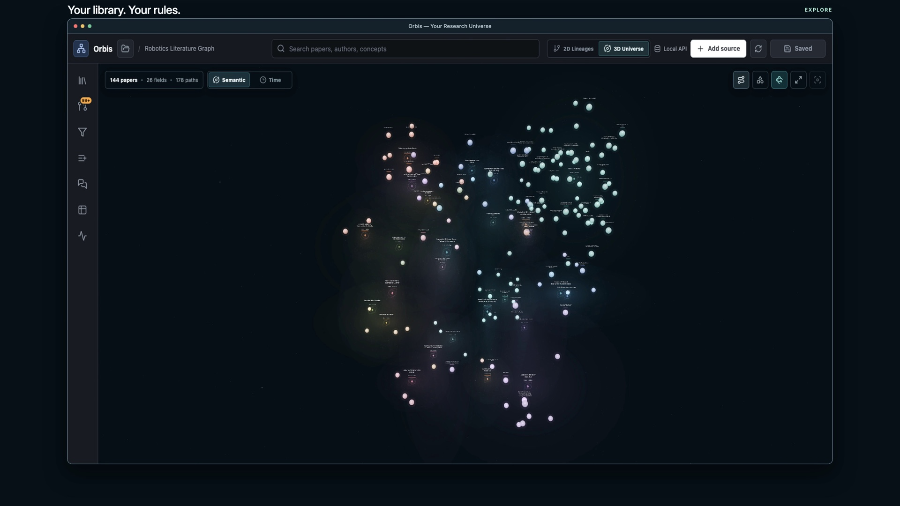
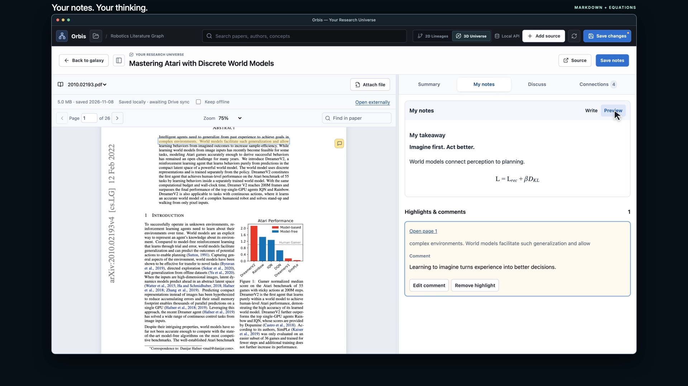
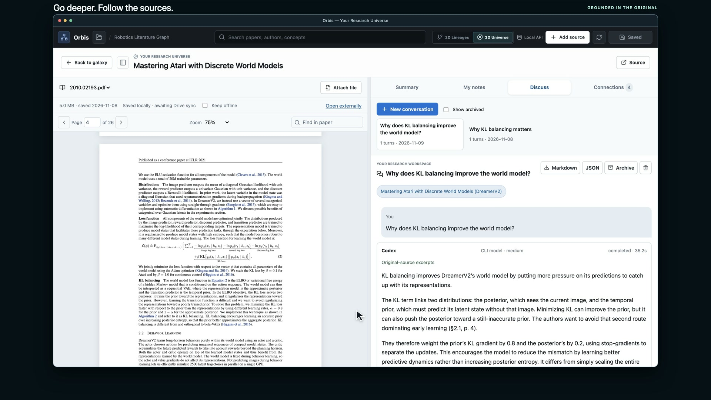
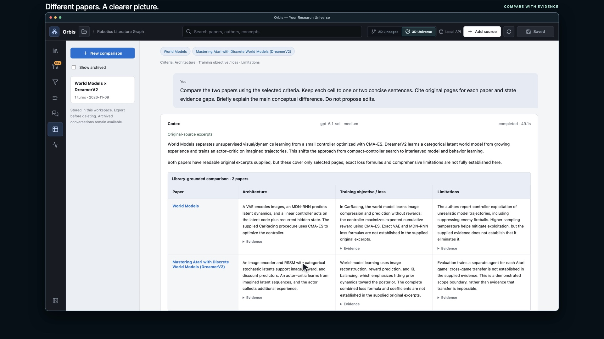

# Orbis

**Read. Take notes. Discuss. Connect. Your research, yours to keep.**

An open-source research workspace for **macOS and Linux**. Bring together papers,
blogs, and web pages; work with your own AI agent; and build a universe of ideas.
Your library lives on your computer, with optional encrypted Google Drive sync.

**[Watch the two-minute demo →](docs/media/orbis-demo.mp4)**



**Explore your research universe.** Rotate the galaxy, focus or filter a cluster,
and hover over connections to see why ideas belong together. Switch to 2D
lineages or keep different projects in independent graphs.

_Images show an example library. Fresh installations start empty; personal
papers and notes are not included._

## The original and your thinking, together



Read the PDF or article beside its summary. Highlight passages, leave comments,
and write your own notes with **Markdown and LaTeX**. Your authored notes stay
separate from generated summaries.

## Ask questions where you read



Use **Codex or Claude Code**, choose your model and effort, and discuss a paper
or selected passage. Answers draw on available original text and show page or
section citations; the app tells you when only stored notes were available.
Review answers before saving them to your notes.

## Compare papers with evidence



Choose papers and comparison criteria, inspect the evidence behind each cell,
ask follow-up questions, and export your table.

### More than a paper reader

- **Add papers, blogs, and web pages.** Review proposed summaries and connections.
  Paper summaries cover the problem, background, framework, results, and limitations.
- **Shape your own library.** Create clusters, methods, and relationships. Keep
  separate graphs for separate projects.
- **Follow agent work.** Activity shows progress and helps recover failed tasks;
  proposed changes need review before application.
- **Keep laptops in sync.** Optional encrypted Drive sync includes notes, graphs,
  discussions, and highlights. Originals download on demand; choose **Keep offline**
  for papers you need without a connection.

## Get started

**Desktop preview · 2.1.0-beta.1.** macOS Apple Silicon and Ubuntu have been
exercised during development. Builds are unsigned and unnotarized, with no
automatic updates. [Verification details →](docs/MAC_VERIFICATION.md)

### Build the desktop app

Install **Git, Node.js 22, and uv** on the computer you will use:

```sh
git clone https://github.com/Nike353/Orbis.git
cd Orbis
npm ci
npm run desktop:build
```

Open the installer in `release/desktop/`: on macOS, drag Orbis from the DMG into
Applications; on Linux, install the DEB or make the AppImage executable and open
it. After installation, launch Orbis with a click—no terminal needed. Build for
your own OS and CPU architecture. [Desktop setup and troubleshooting →](docs/DESKTOP.md)

<details>
<summary><strong>Prefer to try the browser version?</strong></summary>

```sh
git clone https://github.com/Nike353/Orbis.git
cd Orbis
sh start.sh
```

Open the local URL printed in the terminal. First launch prepares managed tools
and can take several minutes. Your library stays outside the application checkout.
Use `sh start.sh --workspace /path/to/my-library` to choose its location.
Google sign-in and encrypted sync require the desktop app.

</details>

### Your first paper

1. Install and sign in to **Codex or Claude Code** for AI features, then restart Orbis.
2. Choose **Add source**, paste a URL, and review the agent's proposal.
3. Choose **Read**, attach or retrieve the original, and try **My notes** or **Discuss**.

Reading and manual editing need no agent. Already have an Orbis library? Import
it through **Local library → Import existing Orbis library** in an empty desktop
installation. [Full user guide →](docs/USER_GUIDE.md)

## Your data, your choices

**Local first.** Each laptop has an independent library and works while the other
is asleep. No Orbis-hosted account or always-on server is required.

**Optional Drive sync.** Files use your Google Drive quota; originals download
on demand, so every device need not store every paper. Sync runs while Orbis is
open and presents conflicting edits for review. Self-built apps need a
[one-time Google configuration](docs/DESKTOP.md#one-time-setup-for-the-app-owner).
Save your recovery key: Google sign-in alone cannot decrypt your library.

**Your agent account.** Orbis uses your installed CLI's provider and account limits.
Passages and notes used in AI requests may be sent to that provider; local agent
integration does not mean on-device inference. Check important claims against
the original. Local working files are not encrypted by Orbis; keep a separate backup.

Windows and mobile clients are not currently supported.
[Security](SECURITY.md) · [Sync and recovery](docs/DESKTOP.md)

## Contribute

[Development guide](CONTRIBUTING.md) · [Architecture](docs/ARCHITECTURE.md) ·
[Data format](docs/SCHEMA.md) · [Release packaging](docs/OPEN_SOURCE.md) ·
[MIT license](LICENSE)
